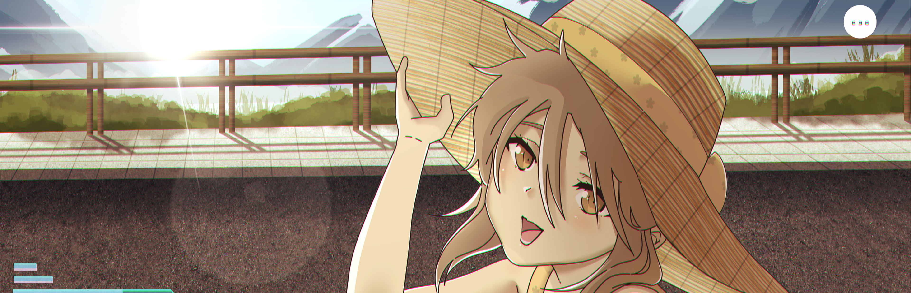
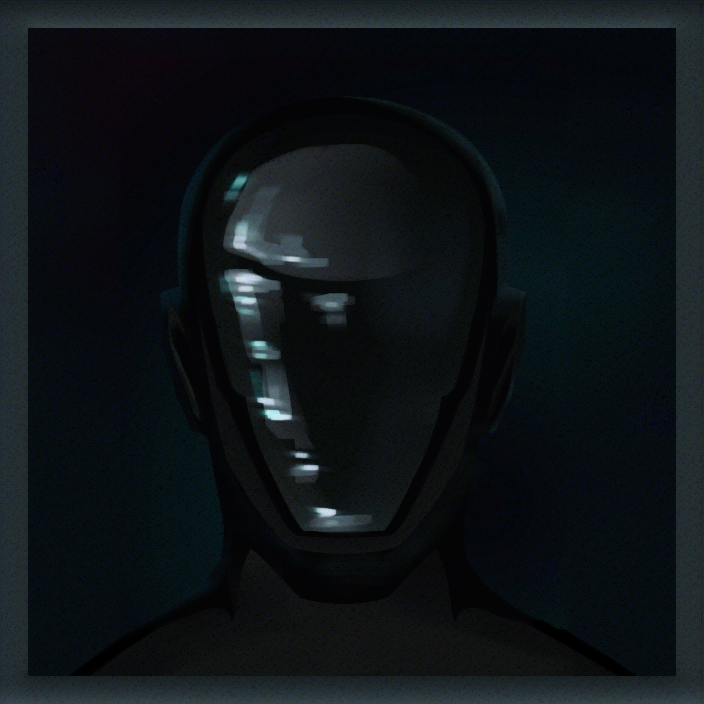

<h1 align="center">The XRUIOS</h1>

  

This is the assembled system, ported from [XRUIOS.Barebones](https://github.com/Walker-Industries-RnD/XRUIOS.Barebones) onto the Plagues trust model. Barebones was one project with ~400 functions. Here each system class is its own **worker process** with its own password and its own key, and a single **XRUIOS.Manager** holds the master key, gates login, and brokers every request through a permission check.

This is a project I knew I wanted to make back since 2017 and after thousands of hours of work, grinding and time it seems things are finally coming together.

  <a href="https://walkerindustries.xyz">Walker Industries</a> •
  <a href="https://discord.gg/H8h8scsxtH">Discord</a>

  <a href="https://walker-industries-rnd.github.io/The-XRUIOS/1-start-here/1-welcome.html"
     style="font-size: 1.4em; color: #58a6ff; text-decoration: none;">
    <strong>Documentation • Examples • Design</strong>
  </a>

## Click the image to view the 3D Spatial Environment coming soon! 

---

## The three walls

1. **Process isolation.** One class per worker. Compromise the Songs worker and you still can't reach Calendar's code - it isn't loaded there.
2. **Password isolation.** Each worker has its own PSK. Only the Manager holds it, so only the Manager can talk to a worker, and a leaked PSK unlocks exactly one worker.
3. **Key isolation.** Each worker's store is encrypted under its own key, derived from the master. A worker only ever receives its own key, so a breach reads its own data and nothing else.

> "Least privilege isn't a setting. It's the architecture."

---

|                                                                              |                                                                                                                                        |
|-----------------------------|-----------------------------|
| **Code by WalkerDev** "Loving coding is the same as hating yourself" [Discord](https://discord.gg/H8h8scsxtH) | **Art & Code by Kennaness** "When will I get my isekai?" [Bluesky](https://bsky.app/profile/kennaness.bsky.social) • [ArtStation](https://www.artstation.com/kennaness) |

 

---

## License & Artwork

**Code:** [NON-AI MPL 2.0](https://raw.githubusercontent.com/non-ai-licenses/non-ai-licenses/main/NON-AI-MPL-2.0)
**Artwork:** — **NO AI training. NO reproduction. NO exceptions.**

> Unauthorized use of the artwork — including but not limited to copying, distribution, modification, or inclusion in any machine-learning training dataset — is strictly prohibited and will be prosecuted to the fullest extent of the law.
